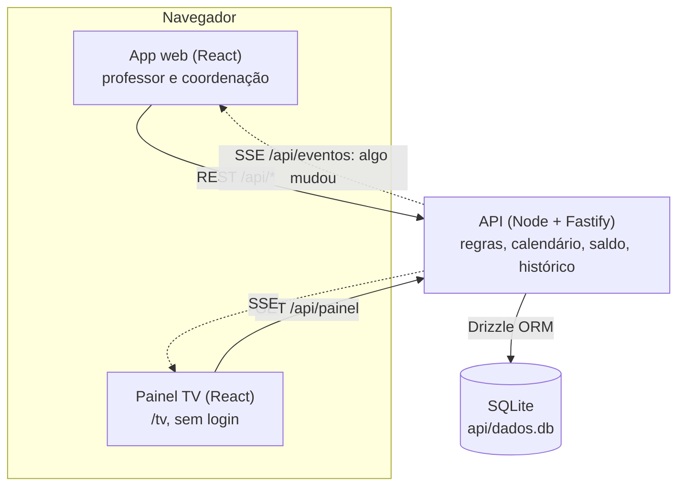

# Permuta Acadêmica

Sistema de gestão e permuta de horários dos cursos noturnos de **SI** e **ADS**: professores trocam aulas com aceite do colega, o saldo de aulas é calculado sozinho, tudo fica no histórico e a TV do saguão mostra a semana atualizada **sem recarregar a página**.

Desenvolvido com **Spec-Driven Development**: cada etapa gerou um artefato revisável e um commit.

| Etapa | Artefato |
|---|---|
| 1. Definir | [`docs/01-spec.md`](docs/01-spec.md) — problema, regras, critérios de aceitação (CA-xx) |
| 2. Planejar | [`docs/02-plano.md`](docs/02-plano.md) — arquitetura, modelo de dados, API |
| 3. Decompor | [`docs/03-tarefas.md`](docs/03-tarefas.md) — tarefas T01–T22 ligadas aos critérios |
| 4. Implementar | `api/` e `web/` — um commit por tarefa (`etapa 4: Txx …`) |
| 5. Validar | `api/testes/` — um teste por critério, nomeado `CA-xx` |

Veja a sequência com `git log --oneline --reverse`.

## Arquitetura



Toda regra mora na API. Depois de cada alteração, a API envia um aviso curto por SSE; as telas buscam os dados de novo. O saldo nunca é guardado: é contado a partir das aulas, que guardam lado a lado a disciplina **prevista** e a **atual**.

## Como rodar

Requer **Node.js 20 LTS ou mais novo** (recomendado 22 LTS).

```bash
npm install        # instala API e front
npm run db:reset   # cria o banco com a massa da demonstração
npm run dev        # API em http://localhost:3333 · sistema em http://localhost:5173
npm test           # 38 testes dos critérios de aceitação
```

- Sistema: <http://localhost:5173>
- Painel da TV: <http://localhost:5173/tv> (use `?data=2026-11-25` para mostrar a semana do roteiro)

### Contas da demonstração (senha `123456`)

| Conta | Perfil |
|---|---|
| `coordenacao@unimater.edu` | Coordenação (cadastros) |
| `ana.souza@unimater.edu` | Banco de Dados II (SI 4º, quinta) e Banco de Dados (ADS 4º, terça) |
| `bruno.lima@unimater.edu` | Engenharia de Software (SI 4º, quarta) |
| `helio.martins@unimater.edu` | Ética e Legislação em TI — **compartilhada** SI 4º + ADS 4º (segunda) |
| … | 14 professores; a tela de login lista todos |

A massa traz o semestre 2026/2 (03/08 a 12/12), 6 turmas, 26 disciplinas, 1.064 aulas, feriados (inclui 20/11) e um histórico de trocas, cancelamento, reposição e um pedido pendente. Cada disciplina ocupa noites inteiras (os dois horários), e toda troca, cancelamento ou reposição é da noite inteira (2 aulas).

## Roteiro de demonstração

1. Abra **/tv?data=2026-11-25** numa janela e o sistema em outra (duas janelas anônimas permitem logar Ana e Bruno ao mesmo tempo).
2. **Ana** → *Solicitar troca* → Compensatória → noite de **quinta 26/11** → **Bruno Lima** → noite de **quarta 25/11** → Enviar. As noites ficam travadas (🔒 na grade).
3. **Bruno** recebe o aviso sem recarregar → *Pedidos* → **Aprovar troca**. A TV atualiza sozinha com o destaque **TROCA** nos dois horários.
4. No informativo, **Compartilhar no WhatsApp**.
5. *Saldo e histórico*: Banco de Dados II e Engenharia de Software continuam com **0 cedidas e 0 assumidas** (permuta equilibrada).
6. **Ana** → Pontual → cede a noite de **quinta 03/12** ao Bruno → Bruno aprova: Ana −2, Bruno +2.
7. **Ana** → *Reposição em noite vaga* → SI 4º, uma **sexta** → saldo volta a zero.
8. **Hélio** cede a noite compartilhada de **segunda 30/11** ao **Bruno** (só leciona no SI 4º): na TV, SI 4º recebe Engenharia de Software e ADS 4º aparece **SEM AULA**.
9. `npm test` — inclusive o teste de concorrência repetido 50 vezes.

## Estrutura

```
api/src/
  db/               tabelas (schema.ts) e migrações
  modulos/
    auth/           login e perfis
    cadastros/      semestre, turmas, professores, disciplinas, feriados, CSV
    calendario/     geração das aulas do semestre
    trocas/         pedidos, aprovação, reposição, cancelamento, travas
    saldo/          cálculo por disciplina e turma
    historico/      registro de eventos
    informativo/    texto para alunos
    painel/         dados públicos da TV
    eventos/        SSE (tempo real)
  carga.ts          massa da demonstração
api/testes/         um arquivo por grupo de critérios (CA-xx)
web/src/
  api/              cliente HTTP, sessão, conexão SSE
  componentes/      peças visuais, layout, informativo
  telas/            login · grade · solicitar · pedidos · saldo · cadastros · painel-tv
```

## Fora de escopo nesta versão

Integração com o LXP, envio automático por WhatsApp/e-mail, login institucional (SSO), outros turnos e implantação em servidor. Detalhes em [`docs/01-spec.md`](docs/01-spec.md#10-fora-de-escopo-nesta-versão).
