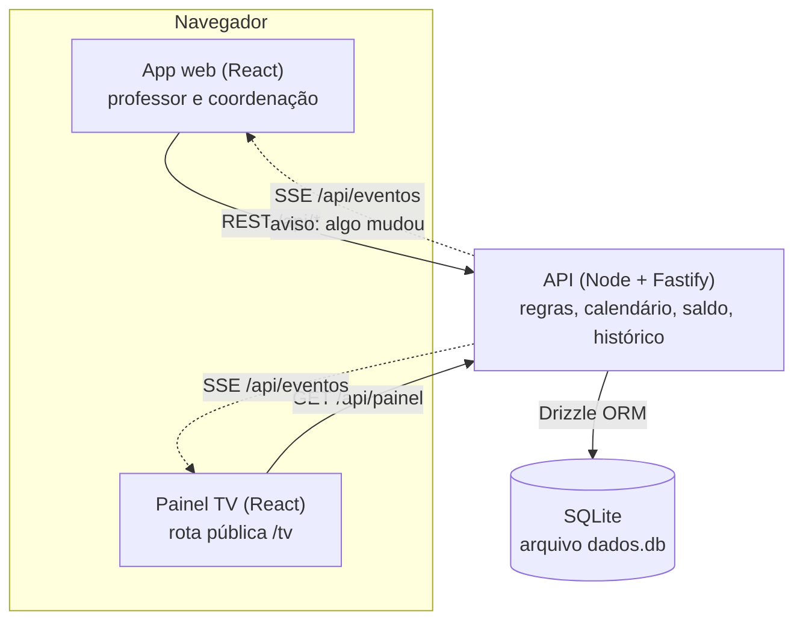
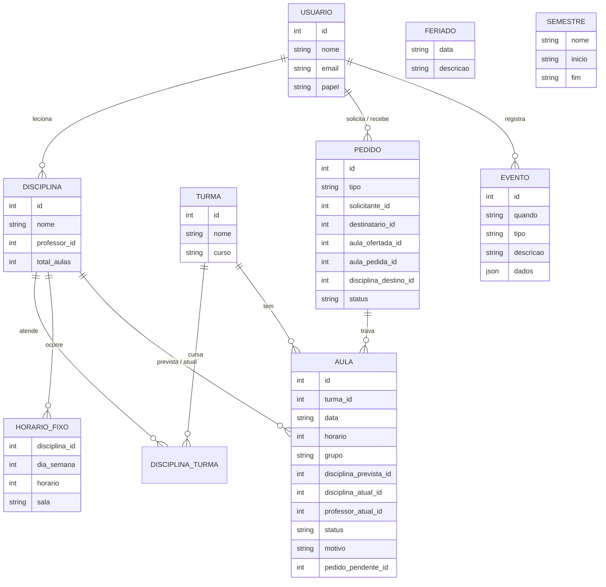
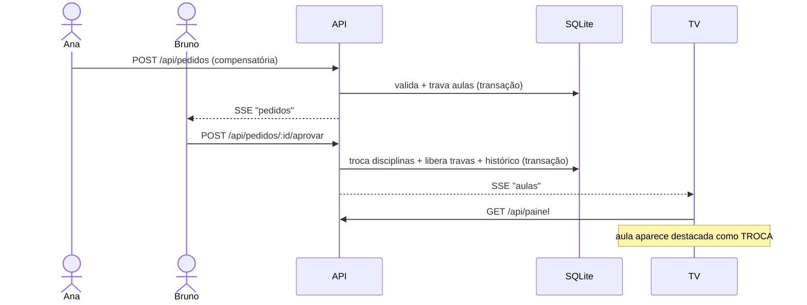

# Etapa 2 — Plano: arquitetura e decisões técnicas

> Deriva de [`01-spec.md`](01-spec.md). Responde **como** o sistema será construído.

## 1. Visão geral



- **Duas telas, uma API, um banco.** O front nunca acessa o banco direto; toda regra mora na API.
- **Linha cheia** = o navegador pede dados. **Tracejada** = a API avisa que algo mudou e as telas buscam de novo.

## 2. Tecnologias

| Camada | Escolha | Por quê |
|---|---|---|
| Linguagem | TypeScript (front e API) | Uma linguagem só; erros de tipo aparecem antes de rodar. |
| Front | React + Vite + Tailwind CSS | Rápido de montar telas; Vite sobe em segundos. |
| Dados no front | TanStack Query | Cache e recarga automática quando chega aviso. |
| Rotas do front | React Router | Telas: login, grade, solicitar, pedidos, saldo, cadastros, TV. |
| API | Fastify + Zod | Leve, simples; Zod valida o corpo das requisições. |
| Banco | SQLite (better-sqlite3) | Um arquivo, sem servidor; transações reais. |
| ORM | Drizzle ORM + drizzle-kit | Tabelas definidas em TypeScript, migrações geradas, consultas tipadas, 100% JavaScript. |
| Tempo real | SSE (Server-Sent Events) | Fluxo só servidor → tela; reconecta sozinho; nativo do navegador. |
| Login | E-mail + senha (bcrypt) + JWT | Simples; trocável por SSO institucional depois. |
| CSV | papaparse (front) | Lê o arquivo e mostra prévia antes de enviar. |
| Testes | Vitest + `app.inject` do Fastify | Testa a API de ponta a ponta sem subir servidor. |

## 3. Estrutura de pastas

Organizada pelo **que o sistema faz**, não por tipo técnico:

```
permuta-academica/
├── docs/                  01-spec · 02-plano · 03-tarefas
├── api/
│   ├── src/
│   │   ├── db/            schema.ts (tabelas) · conexao.ts · migracoes/
│   │   ├── modulos/
│   │   │   ├── auth/          login e perfis
│   │   │   ├── cadastros/     semestre, turmas, professores, disciplinas, feriados, CSV
│   │   │   ├── calendario/    geração das aulas do semestre
│   │   │   ├── trocas/        pedidos, reposição, cancelamento, travas
│   │   │   ├── saldo/         cálculo por disciplina e turma
│   │   │   ├── historico/     registro e consulta de eventos
│   │   │   ├── informativo/   texto padronizado para alunos
│   │   │   ├── painel/        dados públicos da TV
│   │   │   └── eventos/       SSE (avisos em tempo real)
│   │   ├── compartilhado/ datas, horários, erros
│   │   ├── app.ts         monta a API (usado pelo servidor e pelos testes)
│   │   ├── servidor.ts    sobe a API na porta 3333
│   │   └── carga.ts       script de carga da demonstração
│   └── testes/            um arquivo por grupo de critérios (CA-xx)
└── web/
    └── src/
        ├── api/           cliente HTTP e conexão SSE
        ├── componentes/   peças reutilizáveis
        └── telas/         login · grade · solicitar · pedidos · saldo · cadastros · painel-tv
```

## 4. Modelo de dados



### A tabela `aula` é o coração

| Campo | Papel |
|---|---|
| `turma_id`, `data`, `horario` | Identificam a aula. **Índice único parcial**: só existe uma aula *ativa* (não cancelada) por turma, data e horário. Uma aula cancelada pode dividir o horário com a reposição que ocupou o lugar dela. |
| `grupo` | Liga as aulas de uma disciplina compartilhada no mesmo horário. |
| `disciplina_prevista_id` | O que o calendário original mandava (nulo em reposição em horário vazio). |
| `disciplina_atual_id`, `professor_atual_id` | O que vai acontecer de fato (nulos se a aula ficou vaga). |
| `status` | `normal` · `feriado` · `cancelada` · `vaga` |
| `pedido_pendente_id` | Preenchido = aula travada (RN-04). |

**Previsto e atual lado a lado**: uma troca só altera os campos "atual". O sistema sempre sabe o que mudou, a TV destaca quando previsto ≠ atual e o saldo é contado a partir disso (spec, seção 7).

## 5. Operações e regras

| Operação | Efeito nas aulas | Aceite |
|---|---|---|
| **Compensatória** | Grupo A recebe a disciplina/professor de B; grupo B recebe a de A. | Sim |
| **Pontual** | Grupo A recebe a disciplina escolhida do professor B. | Sim |
| **Reposição** | Cria aula em horário vazio ou de aula cancelada, ou preenche aula `vaga`. | Não |
| **Cancelamento** | Aula vira `cancelada` com motivo. | Não |

**Aula compartilhada (RN-02):** ao aplicar a disciplina X num grupo, cada aula do grupo recebe X **se a turma dela for atendida por X**; senão, fica `vaga`.

**Concorrência (RN-09):** toda operação roda numa **transação**, e a trava é um `UPDATE` condicional:

```sql
UPDATE aula SET pedido_pendente_id = :pedido
WHERE grupo = :grupo AND pedido_pendente_id IS NULL
```

Se o número de linhas alteradas não bater com o tamanho do grupo, a transação é desfeita e a API responde **409 Conflito**. Aprovar também é condicional (`... WHERE id = :pedido AND status = 'pendente'`), então um clique duplo não aplica a troca duas vezes.

**Relógio injetável:** a API recebe uma função `agora()`. O servidor usa o relógio real; os testes usam datas fixas.

## 6. Fluxo de uma troca



## 7. API

Todas sob `/api`. Autenticadas por `Authorization: Bearer <token>`, exceto as marcadas como públicas.

| Método e rota | Uso |
|---|---|
| `POST /auth/login` · `GET /auth/eu` | Login e usuário atual |
| `GET /eventos` *(pública)* | Fluxo SSE |
| `GET /painel?data=` *(pública)* | Semana da TV |
| `GET /aulas?inicio=&fim=&professorId=&turmaId=` | Grade |
| `GET /aulas/:id/candidatos` | Colegas disponíveis e suas disciplinas (RF-07) |
| `GET /aulas/:id/contrapartidas?professorId=` | Aulas do colega que podem entrar na compensatória |
| `GET /horarios-vagos?disciplinaId=&turmaId=` | Horários vagos para reposição |
| `POST /pedidos` · `GET /pedidos?caixa=&status=` | Criar e listar pedidos |
| `POST /pedidos/:id/aprovar · /recusar · /cancelar` | Responder pedido |
| `POST /reposicoes` | Reposição em horário vago |
| `POST /aulas/:id/cancelar` | Cancelar aula com motivo |
| `GET /saldo` · `GET /historico` | Saldo e histórico |
| `GET·POST·PUT·DELETE /turmas, /professores, /disciplinas, /feriados` | Cadastros (coordenação) |
| `GET·PUT /semestre` · `POST /semestre/gerar` | Semestre e calendário |
| `POST /importar/:tipo` | Importação CSV (professores, turmas, feriados) |

Erros seguem o formato `{ "erro": "mensagem legível" }`, com 400 (dados inválidos), 401/403 (acesso), 404 e 409 (conflito de regra).

## 8. Tempo real

1. Após qualquer transação confirmada, a API publica um evento curto no SSE: `aulas`, `pedidos` ou `cadastros`.
2. O front tem um único `EventSource` aberto. Ao receber o evento, invalida as consultas correspondentes do TanStack Query, que buscam de novo.
3. O evento **não carrega dados**, só o aviso. Os dados sempre vêm do banco, então nenhuma tela fica divergente.
4. O painel da TV também recarrega a cada 60 s, por segurança, e recalcula a semana à meia-noite.

## 9. Identidade visual

O front segue o visual do portal do aluno da Unimater (JACAD), para o sistema parecer parte do ecossistema da instituição:

| Elemento | Valor |
|---|---|
| Fonte | Roboto |
| Fundo e menu lateral | `#f8f8f8`, divisórias `#ebebeb` |
| Texto | `#4e5155` |
| Ação principal (botões, links) | azul `#3c97fe` |
| Marca (logo) | azul-marinho `#065086` e azul `#2088ca` |
| Avisos de sucesso | verde-menta `#d9f5eb` |
| Cartões | brancos, cantos pouco arredondados, sombra leve |

As cores ficam numa paleta única (`marca`) em `web/src/index.css`; trocar a identidade visual é mexer só ali e no logo (`web/public/logo-unimater.png`).

## 10. Como rodar

```bash
npm install        # instala front e API
npm run db:reset   # cria o banco e carrega a massa da demonstração
npm run dev        # API em :3333, front em :5173
npm test           # testes dos critérios de aceitação
```

Requer Node.js 20 LTS ou mais novo.
